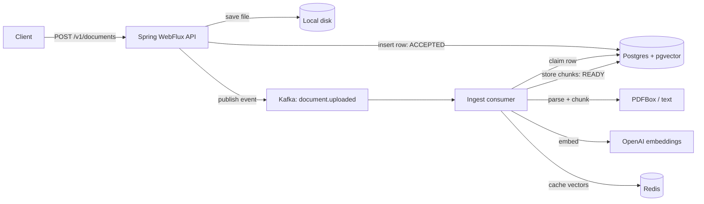
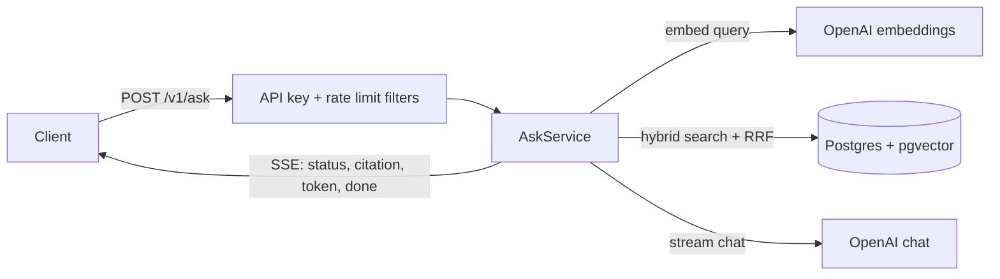

# Smart Context AI

A document Q&A backend. Upload a PDF or text file and the API returns immediately while a Kafka worker parses, chunks and embeds it into Postgres (pgvector). `POST /v1/ask` then runs hybrid search over your documents and streams back citations followed by an answer.

It is an API, not a chat UI. OpenAI is used only for embeddings (`text-embedding-3-small`) and chat (`gpt-4o-mini`).

## Highlights

- **Async ingest.** Upload returns `ACCEPTED` straight away; parsing and embedding run in a Kafka consumer.
- **Duplicate-safe processing.** A conditional `UPDATE` claims the document row, so a redelivered message does not ingest the same document twice.
- **At-least-once consumption.** The Kafka offset is committed only after ingest finishes; failed messages are retried with backoff and the consumer restarts itself if its stream fails.
- **Hybrid retrieval.** pgvector similarity and Postgres full-text search are merged with Reciprocal Rank Fusion.
- **Streaming answers.** Server-Sent Events deliver citations first, then tokens.
- **Degrades instead of failing.** If embeddings or chat fail, the API falls back to keyword search and returns the retrieved passages.
- **Operational basics.** Optional API keys, per-key rate limiting in Redis, embedding cache, Flyway migrations, Prometheus metrics.

## Architecture

Ingest:



Ask:



Document lifecycle: `ACCEPTED` → `CHUNKING` → `EMBEDDING` → `READY`, or `FAILED` (the reason is in `failureReason`). `EMBEDDING` only appears when an OpenAI key is configured.

## Stack

| Layer | Choice |
| --- | --- |
| API | Java 20, Spring Boot 3.4, WebFlux |
| Database | Postgres 16 + pgvector (HNSW and GIN indexes), R2DBC; Flyway over JDBC at startup |
| Queue | Kafka (`document.uploaded`), reactor-kafka |
| Cache / rate limit | Redis |
| Parsing | PDFBox and plain-text files |
| Metrics | Actuator, Micrometer, Prometheus scrape |

## Quick start

Prerequisites: Docker Desktop, JDK 20 or newer (tested on 21), and Gradle (no wrapper is committed yet; tested with 9.7).

1. Create your local env file. It is gitignored.

   ```bash
   cp .env.example .env
   ```

   On Windows PowerShell: `Copy-Item .env.example .env`

2. Edit `.env`:

   ```
   DB_PASSWORD=choose-a-password
   OPENAI_API_KEY=sk-...
   APP_API_KEYS=
   ```

   `OPENAI_API_KEY` needs OpenAI **API** credit (a ChatGPT subscription does not cover it). Without it, ingest still works but stores chunks without vectors and `/v1/ask` returns an error event. Leave `APP_API_KEYS` empty to run without API keys.

3. Start Postgres, Redis and Kafka, then the app:

   ```bash
   docker compose up -d
   gradle bootRun --no-daemon
   ```

4. Check it:

   ```bash
   curl http://localhost:8080/v1/health
   ```

   Expected: `{"app":"UP","postgres":"UP","redis":"UP"}`

Postgres is published on host port **5433** because 5432 is often taken. Changing `DB_PASSWORD` after the first start requires `docker compose down -v`, because Postgres only reads it when the volume is created.

## Try it

On Windows PowerShell use `curl.exe`, or Postman.

```bash
curl -F "file=@notes.txt" http://localhost:8080/v1/documents
curl http://localhost:8080/v1/documents/<documentId>
curl -N -X POST http://localhost:8080/v1/ask \
  -H "Content-Type: application/json" \
  -d '{"query":"What does it use for async ingestion?"}'
```

When `APP_API_KEYS` is set, add `-H "X-API-Key: <your key>"` to each request. `/v1/health` and `/actuator/*` stay public.

Abridged ask response:

```
event:status
data:searching

event:citation
data:[{"chunkId":"...","documentId":"...","filename":"notes.txt","chunkIndex":0,"score":0.0328}]

event:token
data:Kafka

event:done
data:ok
```

## API

| Method | Path | Success | Notes |
| --- | --- | --- | --- |
| GET | `/v1/health` | 200 | App, Postgres and Redis status |
| POST | `/v1/documents` | 200 | Multipart field `file`. Returns `{documentId, status}` |
| GET | `/v1/documents/{id}` | 200 | Poll until `READY` or `FAILED` |
| POST | `/v1/documents/{id}/reindex` | 200 | Re-runs ingest on the stored file |
| DELETE | `/v1/documents/{id}` | 204 | Chunks are removed by cascade, the file is deleted best-effort |
| POST | `/v1/ask` | 200 (SSE) | Body: `{"query": "...", "documentIds": [...]}` |

- `{id}` must be a UUID (36 characters, no braces).
- `documentIds` is optional. Omit it or send `[]` to search every document.
- Supported file types: `.pdf`, `.txt`, `.md`, `.log`, `.java`, `.py`, `.js`, `.ts`, `.json`.
- SSE events: `status`, `citation` (chunk id, document id, filename, chunk index, score), `token`, `done`. Failures such as an empty query or a missing OpenAI key arrive as an `error` event on a 200 response. When nothing relevant exists, `done` carries `insufficient-context`.

Errors from the REST endpoints use `{"error": "..."}`:

| Status | When |
| --- | --- |
| 400 | Unsupported file type, or the id is not a UUID |
| 401 | `APP_API_KEYS` is set and `X-API-Key` is missing or wrong |
| 404 | Unknown document (`GET` returns an empty body; reindex and delete return `{"error":"document not found"}`) |
| 429 | More than 60 requests in a minute for the same key |

## How it works

- **Upload.** The file is stored on disk, a `documents` row is inserted as `ACCEPTED`, and an event keyed by document id is published to Kafka (`acks=all`, idempotent producer).
- **Claiming.** The consumer runs `UPDATE ... SET status='CHUNKING' WHERE id=? AND status IN ('ACCEPTED','FAILED')`. Zero rows updated means another delivery already handled it, so the message is skipped. Reindex may also claim `READY` documents.
- **Delivery.** The offset is committed after ingest completes. A message that fails is retried up to 5 times with exponential backoff, and the whole consumer stream restarts with backoff if it fails.
- **Chunking.** Fixed-size chunks of 1200 characters with 200 characters of overlap.
- **Embeddings.** Cached in Redis for 24 hours, keyed by a SHA-256 of model and text. If OpenAI is unavailable during ingest, chunks are saved without vectors so keyword search still works, and reindex later adds the vectors.
- **Retrieval.** The top 20 chunks by cosine distance and the top 20 by full-text rank are merged with Reciprocal Rank Fusion, `score = 1/(60 + vector rank) + 1/(60 + keyword rank)`, and the best 8 go into the prompt. If the query embedding fails, it falls back to keyword search, then to the latest chunks.
- **Answering.** The prompt tells the model to answer only from the supplied context. OpenAI 429 responses are retried twice; if chat still fails, the retrieved passages are streamed instead.
- **Rate limiting.** A fixed one-minute window per API key (or `anonymous`), counted in Redis. If Redis is down, requests are allowed.
- **Reactive stack.** WebFlux and R2DBC on the request path. PDF parsing is blocking, so it runs on the bounded-elastic scheduler. Flyway uses JDBC once at startup.

## Configuration

| Variable | Purpose |
| --- | --- |
| `DB_PASSWORD` | Postgres password, read from `.env` by Docker Compose and by the app |
| `OPENAI_API_KEY` | Embeddings and chat |
| `APP_API_KEYS` | Comma-separated API keys. Empty means the API is open |

Variables set in your shell override `.env`. Other settings live in [application.yml](src/main/resources/application.yml):

| Property | Default |
| --- | --- |
| `app.rate-limit.requests-per-minute` | `60` |
| `app.cache.embedding-ttl` | `24h` |
| `app.openai.embedding-model` / `chat-model` | `text-embedding-3-small` / `gpt-4o-mini` |
| `app.upload-dir` | `./data/uploads` |
| `app.kafka.topic` / `group-id` | `document.uploaded` / `smart-context-ingest` |

The `embedding` column is `vector(1536)`, which matches `text-embedding-3-small`. Switching to a model with a different dimension needs a new migration.

## Testing

```bash
gradle test --no-daemon
```

The suite covers chunking, the rate limiter (allow, deny, fail-open), the API-key filter and document routes through WebFlux slice tests, file-type validation, and the Kafka consumer's retry and commit behaviour. There are no end-to-end tests against real Postgres, Kafka and Redis yet.

## Metrics

`GET /actuator/prometheus` exposes counters such as `smartcontext_ingest_total`, `smartcontext_retrieval_total`, `smartcontext_openai_total`, `smartcontext_cache_total` and `smartcontext_rate_limit_total`.

## Project layout

```
src/main/java/com/smartcontext/
  controller/    HTTP endpoints and error mapping
  service/       ingest (producer, consumer, service), ask, OpenAI client, cache, rate limit, metrics
  repository/    R2DBC queries (documents, chunks, hybrid search)
  filter/        API key and rate-limit web filters
  dto/ model/    request, response and domain types
  config/        properties, Kafka and WebClient beans
src/main/resources/db/migration/   Flyway migrations
```

## Known limitations

- **Stuck documents.** If the app crashes mid-ingest, the document stays in `CHUNKING` or `EMBEDDING` until you call `POST /v1/documents/{id}/reindex`. There is no stale-claim timeout.
- **No dead-letter topic.** A message that still fails after its retries (roughly half a minute) is logged with the document id and then skipped.
- **Single node.** Uploaded files live on local disk and Kafka runs as one broker, so this is a single-instance setup.
- **Shared API keys.** Any valid key can read, reindex and delete every document; there is no per-user ownership.
- **Simple chunking.** Fixed-size character windows rather than sentence or section boundaries.
- **Public actuator.** Metrics endpoints are unauthenticated so Prometheus can scrape them.
- **OpenAI only.** Embeddings and chat both depend on one provider.

## Demo

### Docker Compose


### Health


### Upload (ACCEPTED)


### Document status (READY)


### Citations


### Metrics


